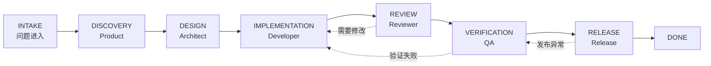

# Agentic Scaffold

> AI 研发数字化基础设施：让 AI 在明确角色、统一上下文、可追踪流程和可验证门禁中参与软件交付。

Agentic Scaffold 是一个轻量、文件优先、工具无关的研发脚手架。它把团队规范、项目知识、任务状态、交付证据和质量门禁沉淀为 Git 可管理的文本资产，让 Codex、Claude Code、Cursor、GitHub Copilot 等工具读取同一套工程上下文。

## 为什么需要它

只给 AI 一段提示词，通常会遇到四个问题：

1. **上下文断层**：每次对话都从零开始，不知道项目架构和历史决策。
2. **角色混淆**：需求分析、实现、评审和测试由同一个视角完成，缺少制衡。
3. **过程不可见**：决策只在聊天里，任务状态和风险无法追踪。
4. **结果不可验证**：代码“看起来完成”，但没有测试、评审和发布证据。

Agentic Scaffold 用四个基础机制解决这些问题：

| 机制 | 落地方式 |
| --- | --- |
| 共享上下文 | `AGENTS.md`、`context/`、角色手册 |
| 任务治理 | `agentic-scaffold task` 状态机与交付产物 |
| 质量门禁 | 设计、评审、验证、发布四个显式阶段 |
| 可观测性 | CLI 统计与本地静态交付看板 |

## 核心能力

- **七类角色协作**：Orchestrator、Product、Architect、Developer、Reviewer、QA、Release。
- **端到端交付状态机**：从 `INTAKE` 到 `DONE`，支持阻塞、返工和取消。
- **零运行时依赖**：核心 CLI 只使用 Python 3.10+ 标准库。
- **按需加载上下文**：项目总览、架构、规范、决策记录相互独立，减少无效上下文。
- **多 AI 工具适配**：同一事实源输出 Codex、Claude Code、Cursor、Copilot 入口。
- **本地优先**：任务数据是可读 JSON，不需要数据库或云服务。
- **开源友好**：默认忽略本地任务产物，提供贡献指南、安全策略和 CI。

## 快速开始

### 1. 安装脚手架

从源码安装：

```bash
git clone https://github.com/HHcola/agentic-scaffold.git
cd agentic-scaffold
python3 -m pip install -e .
```

推荐使用 `pipx` 将命令隔离安装：

```bash
pipx install -e .
```

也可以不安装，直接在仓库根目录运行：

```bash
python3 -m agentic_scaffold --help
```

### 2. 接入项目

新建项目：

```bash
agentic-scaffold init ../my-project \
  --name "My Project" \
  --description "项目一句话简介" \
  --stack "Python, PostgreSQL, React"
```

接入已有项目：

```bash
cd my-existing-project
agentic-scaffold init . \
  --name "My Existing Project" \
  --adopt
```

`--adopt` 只创建缺失文件，已有文件不会被覆盖。接入完成后先检查：

```bash
agentic-scaffold doctor
```

### 3. 创建并推进任务

```bash
agentic-scaffold task new "实现用户登录限流" \
  --type feature \
  --priority P1 \
  --description "同一账号 5 分钟内连续失败 5 次后锁定 15 分钟"

agentic-scaffold task list
agentic-scaffold task show TASK-20261103-001

agentic-scaffold task move TASK-20261103-001 DISCOVERY \
  --note "需求澄清完成"
agentic-scaffold task move TASK-20261103-001 DESIGN \
  --note "进入技术设计"
```

每个阶段会自动创建对应交付文档，任务目录默认位于 `work/TASK-*/`。

### 4. 生成交付看板

```bash
agentic-scaffold dashboard
open work/dashboard.html
```

看板是单文件 HTML，不需要启动服务；可在本地浏览，也可作为构建产物发布。

## 推荐工作流



可以用同一状态机承载不同工作流：

- 新功能：完整七阶段交付。
- Bug 修复：可缩减 `DISCOVERY`，但保留评审和验证证据。
- 技术预研：在 `DESIGN` 阶段形成结论后直接关闭。
- 紧急修复：允许 `--force` 缩短流程，但必须在交付文档记录风险。

详细说明见 [工作流指南](docs/workflow.md)。

## 目录结构

```text
.
├── AGENTS.md                  # 所有 AI 工具的统一入口
├── agents/                    # 角色分工、共同准则和编排协议
├── commands/                  # 可复用任务提示词
├── context/                   # 项目事实、架构、规范和历史决策
├── docs/                      # 使用与架构文档
├── workflows/                 # 场景化交付流程
├── work/                      # 本地任务证据，默认不提交
├── .agentic/config.json       # 脚手架配置
├── .claude/                   # Claude Code 适配
├── .cursor/                   # Cursor 适配
└── .github/                   # Copilot、CI 与开源协作模板
```

## 角色与门禁

| 阶段 | 默认 Owner | 进入下一阶段的最低证据 |
| --- | --- | --- |
| Discovery | Product | `brief.md` 中的目标、范围、验收条件 |
| Design | Architect | `design.md` 中的方案、风险、测试策略 |
| Implementation | Developer | `implementation.md` 中的变更与自测记录 |
| Review | Reviewer | `review.md` 中无阻断问题或已明确返工项 |
| Verification | QA | `verification.md` 中自动化与人工验证证据 |
| Release | Release | `release.md` 中发布、回滚、观测方案 |

角色不是固定的 Agent 数量，而是一组**可以独立审查的职责边界**。你可以用主 Agent 串行切换角色，也可以由编排器把任务交给子 Agent；无论运行方式如何，交付证据和门禁保持一致。

## 上下文维护

项目知识分三层维护：

```text
agents/      → 团队如何协作（低频变化）
context/     → 这个项目是什么（随项目演进）
work/        → 当前任务发生了什么（高频、本地）
```

完成任务后，把经过验证、可跨任务复用的结论从 `work/` 提炼到 `context/`。原始过程记录默认不进入 Git，避免仓库变成聊天日志仓库。

## 适配的 AI 工具

| 工具 | 入口 |
| --- | --- |
| Codex | 自动读取根目录 `AGENTS.md` |
| Claude Code | `CLAUDE.md` 与 `.claude/commands/` |
| Cursor | `.cursor/rules/agentic-scaffold.mdc` |
| GitHub Copilot | `.github/copilot-instructions.md` |
| 其他工具 | 读取 `AGENTS.md` 或复制 `commands/` 中的提示词 |

## 验证

在脚手架源码仓库中运行：

```bash
python3 -m unittest discover -s tests -v
python3 -m agentic_scaffold --help
```

在已接入项目中运行：

```bash
agentic-scaffold doctor
agentic-scaffold task status
```

## 项目状态

当前版本为 `0.1.0`，适合评估、内部试点和作为团队规范基线。接口与配置在 `1.0` 前可能调整，变更会记录在 [CHANGELOG.md](CHANGELOG.md)。

## 文档

- [快速开始](docs/getting-started.md)
- [架构说明](docs/architecture.md)
- [工作流指南](docs/workflow.md)
- [定制指南](docs/customization.md)
- [开源发布检查清单](docs/open-source-checklist.md)
- [贡献指南](CONTRIBUTING.md)

## License

[MIT](LICENSE)
