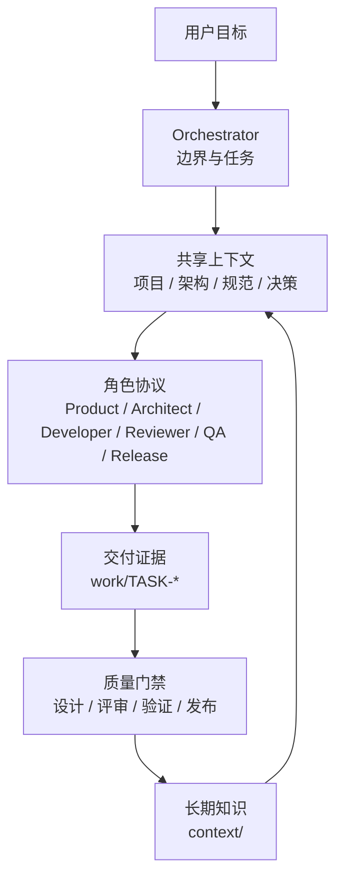

# 架构说明

## 设计目标

Agentic Scaffold 不取代代码仓库、CI、项目管理系统或具体 AI 产品。它提供它们之间共享的**工程协作协议**：



## 组成部分

### 1. 入口层

`AGENTS.md` 是统一事实源，其他工具入口只做薄适配。这样可以避免为每个 AI 工具维护一套互相漂移的规则。

### 2. 角色层

每个角色有独立使命、输入、检查清单、输出和停止条件。角色不绑定具体模型，也不要求固定 Agent 数量。

### 3. 上下文层

- `context/project/`：项目定位、术语、边界。
- `context/architecture/`：系统事实。
- `context/standards/`：可执行工程规范。
- `context/decisions/`：长期架构决策。

按需加载是关键设计。把所有项目知识塞进入口文件会增大上下文成本，并让信息更难更新。

### 4. 状态层

CLI 在 `work/` 中保存结构化任务元数据和阶段交付物：

```text
INTAKE
  → DISCOVERY
  → DESIGN
  → IMPLEMENTATION
  → REVIEW
  → VERIFICATION
  → RELEASE
  → DONE
```

`BLOCKED` 和 `CANCELLED` 可从活跃状态进入；返工允许回到实现或验证。

### 5. 证据层

阶段文档不是形式主义，而是下游可以审查的最小事实包。CLI 会在进入阶段时自动创建模板，但只有实际内容才构成证据。

### 6. 观测层

`task status` 提供终端统计，`dashboard` 生成单文件 HTML。任务数据是普通 JSON，可进一步接入企业看板、数据仓库或 CI 报表。

## 为什么本地优先

- 不依赖数据库和网络即可开始。
- 文本与 Git 天然可审计、可分支、可合并。
- AI 工具可以直接读取，无需额外查询层。
- 在团队规模扩大后，可用同一 schema 派生集中式观测。

## 为什么任务证据默认不入库

过程日志数量大、噪音高，还可能包含敏感路径和临时信息。仓库保存的是：

1. 代码与测试。
2. 稳定的项目知识。
3. 经确认的工程规范。
4. 重要架构决策。

短周期任务证据保留在本地或 CI artifact；需要审计时可调整 `.gitignore` 并制定保留策略。

## 扩展点

- **工具入口**：增加薄适配文件，继续复用 `AGENTS.md`。
- **角色**：复制 `agents/roles/` 的模式增加 Security、Data 或 UX。
- **工作流**：在 `workflows/` 增加场景说明，复用状态机。
- **集成**：根据任务 JSON 和阶段文档接入项目管理系统、CI 或内部看板。
- **策略**：在 CLI 或 CI 外增加组织特有的门禁检查。

## 明确非目标

- 不替代代码托管、CI/CD、工单系统和权限系统。
- 不自动证明 AI 输出正确。
- 不强制所有团队使用相同模型或 SaaS。
- 不把聊天记录当作项目文档。
