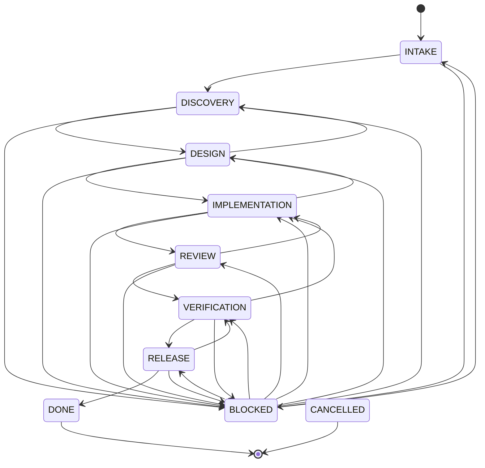

# 工作流指南

## 状态机

| 状态 | 目的 | 默认 Owner | 自动创建的文档 |
| --- | --- | --- | --- |
| `INTAKE` | 问题进入 | orchestrator | `brief.md`、`plan.md`、`journal.md` |
| `DISCOVERY` | 需求与验收 | product | `brief.md` |
| `DESIGN` | 方案与风险 | architect | `design.md` |
| `IMPLEMENTATION` | 实现与自测 | developer | `implementation.md` |
| `REVIEW` | 独立评审 | reviewer | `review.md` |
| `VERIFICATION` | 独立验证 | qa | `verification.md` |
| `RELEASE` | 发布与观测 | release | `release.md` |
| `DONE` | 完成归档 | orchestrator | 无 |
| `BLOCKED` | 外部阻塞 | 当前 Owner | 无 |
| `CANCELLED` | 取消 | orchestrator | 无 |

## 合法流转



CLI 默认校验流转。`--force` 只用于真实紧急流程，并在 `task.json` 记录 `forced: true`。

## 阶段证据

### Discovery

```text
用户/场景 + 问题 + 目标 + 非目标 + 验收条件 + 未知项
```

### Design

```text
方案 + 备选方案 + 关键权衡 + 数据/接口变化 + 风险 + 测试策略 + 回滚边界
```

### Implementation

```text
变更文件与行为 + 自动化测试命令 + 实际结果 + 已知限制
```

### Review

```text
发现级别 + 代码位置 + 影响 + 建议 + 是否阻断
```

### Verification

```text
验收条件 → 测试用例 → 环境 → 实际结果
```

### Release

```text
发布步骤 + 健康检查 + 指标/日志 + 回滚步骤 + 实际结果
```

## 多人/多 Agent

- 每个角色先读取最新任务状态和文件。
- 写同一任务时避免同时覆盖同一文档。
- Reviewer 和 QA 必须基于稳定实现基线工作。
- Orchestrator 在推进状态前确认各角色结论没有互相冲突。

## 阻塞处理

```bash
agentic-scaffold task move TASK-YYYYMMDD-NNN BLOCKED \
  --note "等待 X；解除条件 Y；责任人 Z"
```

阻塞解除后，明确选择恢复状态：

```bash
agentic-scaffold task move TASK-YYYYMMDD-NNN DESIGN \
  --note "依赖已就绪，恢复设计"
```
